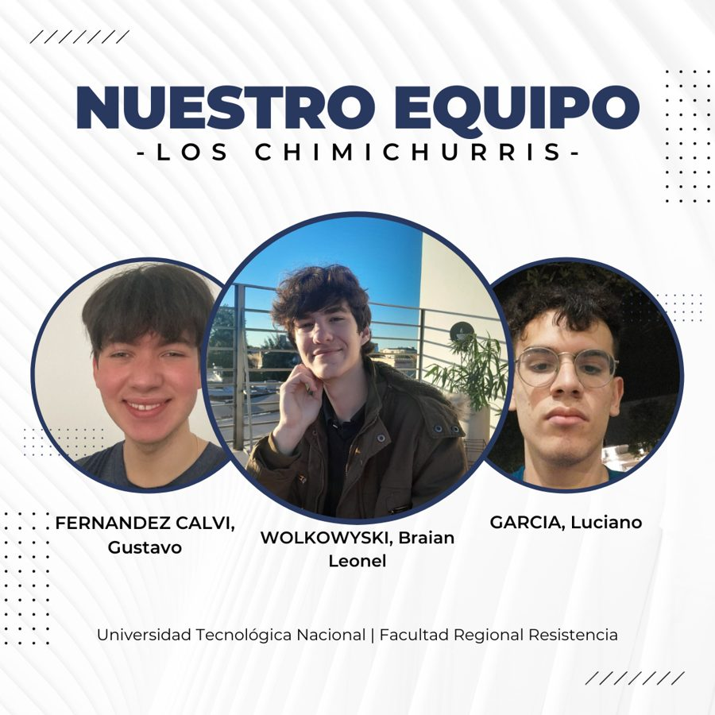

# Laboratorios

## Pascal — Tema 1

- [`pascal/tema-1-pseudocodigo.pseudo`](pascal/tema-1-pseudocodigo.pseudo): el algoritmo en pseudocódigo.
- [`pascal/tema-1.pas`](pascal/tema-1.pas): el programa en Pascal. Lee una secuencia de registros de sustancias (`SecuenciaStar.txt`), pasa las cantidades de libras a kilogramos y emite los totales por mes.
- [`pascal/practica-velocidad-cohete.pas`](pascal/practica-velocidad-cohete.pas): primer programa de prueba.

```
fpc tema-1.pas
```

## C — Tema 3: votación electrónica (grupal)

Grupo **Los Chimichurris**: Gustavo Fernández Calvi, Braian Leonel Wolkowyski y Luciano García (2023).



Sistema de votación para elegir entre 5 candidatos a gerente: carga de candidatos, votación con validación de votos y resultados con el ganador.

- [`c-los-chimichurris/tema-3-pseudocodigo.pseudo`](c-los-chimichurris/tema-3-pseudocodigo.pseudo): el pseudocódigo.
- [`c-los-chimichurris/tema-3.c`](c-los-chimichurris/tema-3.c): el programa en C.
- [`c-los-chimichurris/informe-lab-c-tema-3.pdf`](c-los-chimichurris/informe-lab-c-tema-3.pdf): el informe que entregamos (enunciado, pseudocódigo y código). También está el [`.docx`](c-los-chimichurris/informe-lab-c-tema-3.docx) original.
- Videos del informe: [video grupal](https://youtu.be/7NXWcJI3-60) · [video extra](https://youtu.be/AJ3MDhPL1wU).

```
gcc tema-3.c -o votacion
```
